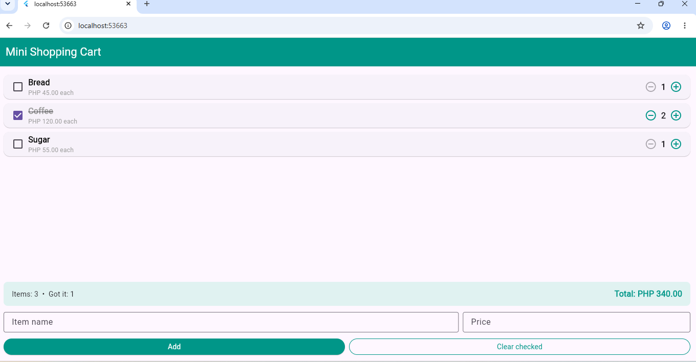

# Stateful Lab - Rozano

**Activity:** Laboratory Activity No. 3 — Building a Mini Shopping Cart with StatefulWidget

**Name:** Lovely Joy B. Rozano

## Description

This Flutter application demonstrates the use of StatefulWidget to build a mini shopping cart. It allows users to add items, change quantities, mark items as received, view the total price, and clear checked items.

## Screenshot

